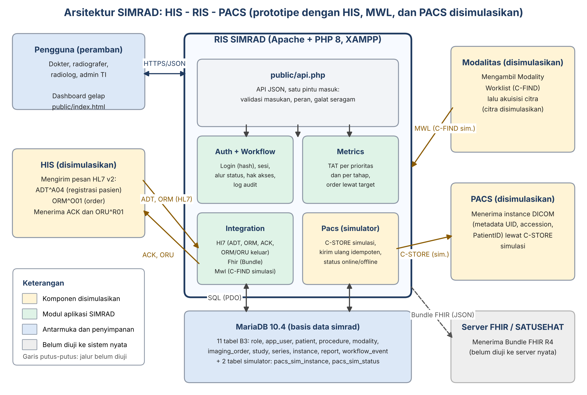

# SIMRAD – Prototipe RIS (Deliverable D, UAS Sistem Informasi Radiologi)

Prototipe sistem informasi radiologi untuk skenario fiktif RSUD Bina Sehat (tipe B, 220 tempat tidur): order pemeriksaan,
worklist, status studi (ORDERED → SCHEDULED → IN_PROGRESS → COMPLETED → REPORTED), laporan radiologi, metrik TAT,
jejak audit, registrasi pasien, simulasi Modality Worklist dan PACS, serta pesan integrasi HL7 v2 dan FHIR. Dibuat untuk UAS Magister Terapan Imejing Diagnostik, Universitas Airlangga.

> **Semua data pada prototipe ini fiktif.** Citra DICOM **disimulasikan** (hanya jumlah dan UID-nya yang dicatat); tidak ada berkas DICOM nyata.

## Mulai cepat (5 langkah, tanpa penjelasan lisan)
Prasyarat: **XAMPP** dengan PHP 8.1 atau lebih baru (diuji PHP 8.2.4 dan MariaDB 10.4.28 di macOS; Windows memakai jalur `C:\xampp\htdocs`).
1. Buka XAMPP, nyalakan **Apache** dan **MySQL** (keduanya harus berstatus hijau).
2. Unduh repositori ini (tombol **Code > Download ZIP**), bongkar, lalu salin isinya ke `htdocs` sebagai folder bernama **`simrad`** (persis itu; tanpa spasi, tanpa akhiran `-main`):
   `/Applications/XAMPP/xamppfiles/htdocs/simrad/` (macOS) atau `C:\xampp\htdocs\simrad\` (Windows). Setelah disalin, harus ada berkas `htdocs/simrad/public/api.php`.
3. Buka `http://localhost/phpmyadmin`, tab **Impor**, pilih `db/schema.sql` lalu **Kirim**; ulangi untuk `db/seed.sql`. (Skema membuat basis data `simrad` sendiri.)
4. Buka `http://localhost/simrad/public/` dan masuk dengan `d001` / `simrad2026` (dokter). Akun lain di bagian 5.
5. Untuk data contoh di dashboard: `php db/demo_seed.php` (di macOS: `/Applications/XAMPP/xamppfiles/bin/php db/demo_seed.php`, dijalankan dari folder `simrad`). Untuk menjalankan pengujian lihat bagian 6.

**Bila gagal:** halaman 404 berarti nama folder bukan persis `simrad` atau berkas tidak berada di `htdocs/simrad/public/`; `{"error":{"kode":"GALAT_SERVER"...}}` biasanya berarti MySQL belum menyala atau skema belum diimpor; `BELUM_LOGIN` pada alamat `api.php` adalah **normal** (tanda aplikasi hidup).

## Arsitektur


*Kuning = komponen yang disimulasikan; garis putus-putus = jalur yang belum diuji ke sistem nyata.*

SIMRAD adalah aplikasi web tiga lapis: **antarmuka** (satu halaman HTML), **API JSON** (PHP), dan **basis data** (MariaDB). HIS, modalitas, dan PACS **disimulasikan**.

| Lapisan | Berkas | Peran |
|---|---|---|
| Antarmuka | `public/index.html` | Dashboard mode gelap untuk dokter, radiografer, radiolog, dan Admin TI; memanggil API. |
| API | `public/api.php` | Satu pintu masuk (`?r=rute`): validasi masukan, pemeriksaan peran, galat JSON seragam. |
| Alur kerja | `src/Auth.php`, `src/Workflow.php` | Login (hash kata sandi), aturan status order, hak akses per peran, log audit, kirim ke PACS. |
| Metrik | `src/Metrics.php` | TAT per prioritas dan per tahap, order yang melewati target. |
| Integrasi | `src/Integration.php` | Pesan HL7 v2 (ADT, ORM masuk dengan ACK; ORM, ORU keluar), Modality Worklist (simulasi C-FIND), Bundle FHIR R4. |
| PACS simulasi | `src/Pacs.php` | Meniru C-STORE; dapat dimatikan untuk menguji gagal kirim dan kirim ulang. |
| Basis data | `db/schema.sql` | 11 tabel (rancangan ERD Deliverable B3) dan 2 tabel simulator PACS. |

**Aliran data utama:** (1) HIS mengirim ADT^A04 dan ORM^O01 ke RIS dan menerima ACK; (2) radiografer menjadwalkan order, yang lalu tampil di Modality Worklist; (3) pemeriksaan selesai, studi dikirim ke PACS simulasi (bila gagal, dicatat dan dapat dikirim ulang); (4) radiolog menulis laporan final; (5) hasil dikirim balik ke HIS sebagai ORU^R01 dan dapat diekspor sebagai Bundle FHIR. Penjelasan lengkap, data dictionary, dan API ada di `docs/Dokumentasi_Teknis_SIMRAD.pdf`.

## 1. Asal aplikasi dasar dan kontribusi penulis
- **Aplikasi dasar RIS** (data pasien, worklist, pengiriman MWL, pengecekan PACS Conquest, viewer OHIF) **dikirimkan langsung oleh dosen
  kepada mahasiswa kelas** untuk keperluan tugas ini, dan digunakan dengan persetujuan beliau. Salinan aslinya disimpan **tanpa diubah** di folder `APLIKASI DASAR/`.
- **Master data awal** (100 pasien fiktif, jenis pemeriksaan, nama tenaga kesehatan, ruang/alat) diambil dari data dasar tersebut (`db/seed.sql`).
  Pemeriksaan gigi (IO, PX) tidak dimasukkan karena di luar lingkup SIMRAD.
- **Dikembangkan untuk UAS ini** (folder `simrad/`): skema basis data 11 tabel sesuai Deliverable B3, alur status dan hak akses per peran,
  log audit, metrik TAT, antarmuka dashboard, modul integrasi HL7/FHIR, serta seluruh pengujian.
- **Penggunaan AI:** kode pada `simrad/` ditulis oleh Claude (Anthropic) atas arahan penulis; penulis memasang, menjalankan, dan menguji di XAMPP macOS.
  Rincian ada pada deklarasi penggunaan AI di dokumen pengumpulan.
- **PACS dan Modality Worklist disimulasikan oleh SIMRAD sendiri** (`src/Pacs.php`, `Mwl` di `src/Integration.php`); modul PACS/Conquest milik aplikasi dasar dosen **tidak** diadaptasi atau diuji (lihat bagian 9).

## 2. Keterkaitan dengan Deliverable A dan B
| Rancangan | Wujud di prototipe | Bukti uji |
|---|---|---|
| B3 ERD 11 entitas, hierarki DICOM (Study, Series, Instance) | `db/schema.sql` | `hasil_uji.md` TC09 |
| B2 activity diagram: decision CITO (D1) dan kualitas citra (D3) | `Workflow::markCito`, `Workflow::complete` (ulangi pengambilan) | TC13, TC17 |
| B4 hak akses per peran (dokter, radiografer, radiolog, admin TI) | pemeriksaan peran di `Workflow` dan `Integration` | TC07, TC14, TC19, TC20, TC33 |
| B4 log audit; UU PDP Pasal 31 | tabel `workflow_event` | TC22 |
| B4 kata sandi di-hash | `app_user.password_hash` (bcrypt via `password_hash`) | TC01, TC02 |
| B5 mode gelap, minimalis, pencegahan galat (konfirmasi CITO, alat OFFLINE ditolak) | `public/index.html` | UI01–UI36 (`tests/ui_test.js`) |
| Skenario: TAT CITO < 60 menit, reguler < 120 menit; dashboard KPI | `Metrics::summary`, kartu KPI | IT01–IT04 |
| A: DICOM (UID 2.25.*, ≤ 64 karakter) | `Workflow::newUid` | TC09 |
| A: HL7 v2 (ORM/ORU) dan FHIR | `src/Integration.php` | TC25–TC34 |
| A3 sequence: ADT, ORM, ACK, MWL, C-STORE, ORU | `Hl7::terima`, `Mwl`, `Pacs`, `Hl7::oruHasil` | TC39–TC46 |
| B2 decision D2: gagal kirim ke PACS | `Workflow::complete`, `kirimUlangPacs` | TC44 |
| D1: registrasi pasien | `Workflow::createPatient`, dialog "Registrasi pasien" | TC35–TC38, UI28–UI29 |
| A4: kegagalan HTTP 412 pada payload identik | bundle FHIR memakai conditional create (`ifNoneExist`) agar kirim ulang tidak menggandakan data | TC31 |

## 3. Perubahan terhadap rancangan B (log revisi)
- `app_user` ditambah kolom `password_hash VARCHAR(255)` (B4 menyebut kata sandi di-hash; kolomnya belum tertulis di tabel B3).
- Indeks tambahan `idx_order_worklist` dan `idx_event_order`.
- Modalitas dibatasi CT, MR, DX, US seperti B3; data gigi (IO, PX) dari data dasar tidak dimuat.
- Nomor akses berformat `ACC` + tanggal (YYYYMMDD) + nomor urut 5 digit.
- Urutan worklist: order terbuka di atas, lalu CITO sebelum reguler, lalu waktu order (ditemukan perlu setelah dicoba di antarmuka).

## 4. Prasyarat, pemasangan, dan konfigurasi
- **Prasyarat:** PHP 8.1 atau lebih baru dengan ekstensi `pdo_mysql` (ekstensi `mbstring` dianjurkan; ada cadangan bila tidak aktif); MariaDB atau MySQL; peramban modern (diuji di Safari). Untuk `tests/load_multiuser.php` diperlukan ekstensi `curl` (ada di XAMPP).
- **Pemasangan:** ikuti "Mulai cepat" di atas. Skema (`db/schema.sql`) **menghapus dan membuat ulang** tabel; jangan diimpor pada basis data `simrad` yang sudah berisi data yang ingin dipertahankan. Dua tabel simulator PACS dibuat otomatis saat pertama dipakai.
- **Mengubah data awal ke kondisi bersih:** impor ulang `db/schema.sql` lalu `db/seed.sql`.
- **Konfigurasi:** `config.php` (bawaan XAMPP: `root` tanpa kata sandi, **hanya untuk lokal**). Di luar lokal gunakan pengguna basis data khusus lewat variabel lingkungan `SIMRAD_DB_HOST`, `SIMRAD_DB_PORT`, `SIMRAD_DB_NAME`, `SIMRAD_DB_USER`, `SIMRAD_DB_PASS`.
- **Simulasi PACS mati:** masuk sebagai `adm01`, klik **Simulasikan PACS mati** pada dashboard; selesaikan sebuah pemeriksaan sebagai radiografer untuk melihat tanda **PACS gagal**, lalu nyalakan PACS dan klik **Kirim ulang PACS**.

## 5. Akun demo dan data demo
Kata sandi demo semua akun: `simrad2026` (hanya lingkungan lokal). Akun: `d001` (dokter), `r001` (radiografer), `rad01` (radiolog), `adm01` (admin TI).
Data contoh untuk dashboard dan video: `php db/demo_seed.php` (mengosongkan order, studi, laporan, dan log; membuat 14 order fiktif relatif terhadap jam sekarang).

## 6. Pengujian
```
SIMRAD_URL=http://localhost/simrad/public/api.php /Applications/XAMPP/xamppfiles/bin/php tests/run_tests.php   # black box + integrasi; menulis docs/hasil_uji.md
AB=/Applications/XAMPP/xamppfiles/bin/ab BASE=http://localhost/simrad/public/api.php sh tests/load_test.sh      # uji beban (ab); menambah docs/hasil_beban.txt
```
```
SIMRAD_URL=http://localhost/simrad/public/api.php /Applications/XAMPP/xamppfiles/bin/php tests/load_multiuser.php 20   # 20 pengguna serentak, sesi berbeda; menambah docs/hasil_beban_multiuser.txt
```
`run_tests.php` mengosongkan data transaksi, menghapus pasien tambahan (id di atas 100) dan data PACS simulasi, lalu menyalakan PACS simulasi; jalankan `db/demo_seed.php` sesudahnya bila ingin data demo. `tests/ui_test.js` (Node + jsdom) menguji logika layar untuk tiap
peran; ia tidak menilai tampilan visual dan hanya dijalankan di lingkungan pengembang.

## 7. Endpoint API (`public/api.php?r=<rute>`)
| Rute | Metode | Peran yang berhak |
|---|---|---|
| `login`, `logout`, `me` | POST, POST, GET | semua |
| `patients`, `procedures`, `modalities` | GET | dokter, radiografer, radiolog (modalities dan procedures: semua yang login) |
| `orders`, `orders.detail` | GET | dokter (milik sendiri), radiografer, radiolog |
| `orders.create` | POST | dokter |
| `orders.schedule`, `orders.start`, `studies.complete` | POST | radiografer |
| `reports.save` | POST | radiolog |
| `orders.cito` | POST | dokter, radiolog |
| `metrics` | GET | semua (agregat tanpa identitas pasien) |
| `hl7.order`, `hl7.hasil`, `fhir.bundle` | GET | dokter (milik sendiri), radiografer, radiolog |
| `patients.create` | POST | dokter, radiografer |
| `hl7.terima` (ADT^A04, ORM^O01 masuk; dibalas ACK) | POST | dokter, radiografer |
| `mwl.daftar` (simulasi Modality Worklist) | GET | radiografer |
| `studies.kirim_ulang` (kirim ulang ke PACS) | POST | radiografer |
| `pacs.status` | GET | semua |
| `pacs.set` (simulasi PACS mati/hidup) | POST | Admin TI |

## 7a. Alur HIS - RIS - PACS (simulasi), sesuai sequence diagram A3
1. **HIS** mengirim `ADT^A04` (registrasi pasien) dan `ORM^O01` (order) ke `hl7.terima`; RIS membalas **ACK** (`AA` diterima, `AE` galat data, `AR` ditolak). Pengiriman ulang ADT dengan nomor RM yang sama aman (dijawab AA tanpa menggandakan).
2. Radiografer menjadwalkan order; order tampil di **Modality Worklist** (`mwl.daftar`) dalam atribut DICOM bernama tag (PatientName, PatientID, AccessionNumber, ScheduledProcedureStepSequence, dan seterusnya).
3. Setelah pemeriksaan diselesaikan, studi dikirim ke **PACS simulasi** (meniru C-STORE). Bila PACS mati, studi **tidak hilang**: kegagalan dicatat (`PACS_SEND_FAILED`) dan studi dapat dikirim ulang (`studies.kirim_ulang`, idempoten).
4. Laporan final dikirim balik ke HIS sebagai `ORU^R01` (`hl7.hasil`).
Seluruh alur diuji ujung ke ujung pada TC43 dengan membandingkan setiap atribut pasien dan setiap UID instance di RIS dan PACS. Tabel simulator (`pacs_sim_instance`, `pacs_sim_status`) dibuat otomatis dan **bukan bagian ERD B3**.

## 8. Pemetaan integrasi
**HL7 v2.5.1** (`Hl7`): `ORM^O01` (order) dan `ORU^R01` (hasil). Karakter khusus di-escape (`\F\ \S\ \R\ \E\ \T\`, baris baru `\.br\`).
| Data SIMRAD | Field HL7 |
|---|---|
| no. RM | PID-3 (`<no_rm>^^^SIMRAD^MR`) |
| nama | PID-5 (kata terakhir = nama keluarga; penyederhanaan) |
| tanggal lahir, jenis kelamin (L/P) | PID-7, PID-8 (M/F) |
| no. akses | ORC-2, ORC-3, OBR-2, OBR-3 (`<acc>^SIMRAD`) |
| prioritas CITO / reguler | ORC-7 komponen 6: `S` / `R` |
| status order | ORC-5 (ORDERED=IP, SCHEDULED=SC, IN_PROGRESS=IP, COMPLETED=A, REPORTED=CM) |
| pemeriksaan, modalitas | OBR-4 (`kode^nama^SIMRAD`), OBR-24 |
| hasil final | OBR-25 = `F`; OBX (TX) temuan dan kesimpulan, OBX-11 = `F` |

**FHIR R4** (`Fhir`): satu Bundle `transaction` per order berisi `Patient`, `ServiceRequest` (priority `stat`/`routine`), `ImagingStudy`
(identifier `urn:dicom:uid` = `urn:oid:<UID studi>`, series dan instance), dan `DiagnosticReport` (`final`, `preliminary`, atau `appended` untuk addendum).
Setiap entri memakai `ifNoneExist` (conditional create). Identifier memakai URN lokal (`urn:simrad:...`); **belum dipetakan ke SATUSEHAT**
(kecuali NIK bila terisi, memakai sistem `https://fhir.kemkes.go.id/id/nik`). SOP Class pada ImagingStudy bersifat nominal menurut jenis alat karena citra simulasi.
Validasi: seluruh bundle lolos model FHIR R4B (pustaka `fhir.resources`, dijalankan di lingkungan pengembang). **Pengiriman ke server FHIR nyata belum diuji**; skrip: `integrasi/kirim_ke_hapi.php`.

## 9. Keterbatasan
Lengkapnya di `CATATAN_BUG.md` (bagian "Masalah yang diketahui dan belum diperbaiki"). Ringkas: citra, MWL, dan PACS disimulasikan; pendaftaran pasien belum masuk log audit; HL7/FHIR belum diuji ke penerima nyata;
belum ada pembatasan percobaan login dan token CSRF; satu sesi uji beban dan satu pengguna tidak mewakili beban rumah sakit; tampilan hanya dicoba di Safari.

## 9a. Dokumentasi
- `docs/Dokumentasi_Teknis_SIMRAD.pdf`: arsitektur, aturan bisnis, data dictionary, API, pemetaan HL7 dan FHIR, perbedaan terhadap rancangan.
- `docs/Panduan_Pengguna_SIMRAD.pdf`: panduan non-teknis untuk radiografer dan radiolog.
- `CATATAN_BUG.md`: bug yang ditemukan (berlevel Critical, Major, Minor) dan masalah yang diketahui.
- **Perbedaan penting terhadap rancangan B:** gagal kirim ke PACS belum diantre ulang otomatis 3 kali (B2); prototipe mencatat kegagalan dan menyediakan kirim ulang manual (KNOWN-13).

## 10. Struktur folder
```
config.php          konfigurasi basis data dan target TAT
db/                 schema.sql, seed.sql, demo_seed.php
src/                Auth, Workflow (alur kerja), Metrics, Integration (HL7, FHIR), bootstrap
public/             api.php (API JSON), index.html (dashboard)
integrasi/          kirim_ke_hapi.php (menyimpan atau mengirim bundle FHIR)
tests/              run_tests.php, ui_test.js, load_test.sh
docs/               arsitektur.png, Dokumentasi_Teknis_SIMRAD.pdf, Panduan_Pengguna_SIMRAD.pdf; hasil_uji.md dan hasil_beban*.txt dibuat oleh pengujian
```

## 11. Catatan riwayat commit
Pengembangan berlangsung di salinan kerja lokal tanpa kontrol versi. Repositori ini disusun pada 20-21 November 2026 dengan mengunggah komponen secara bertahap (kerangka dan basis data, backend, antarmuka, pengujian, dokumentasi), sehingga riwayat commit mencerminkan **tahap penyusunan repositori**, bukan urutan pengetikan kode. Waktu pada commit adalah waktu sebenarnya. Kode ditulis dengan bantuan Claude (Anthropic) atas arahan penulis (lihat bagian 1).
